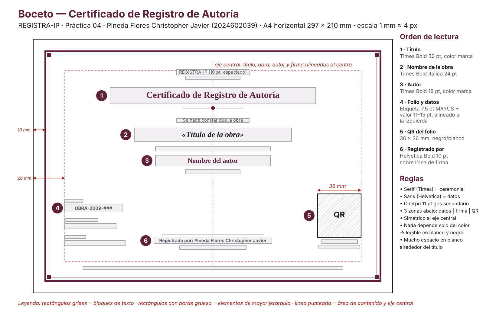
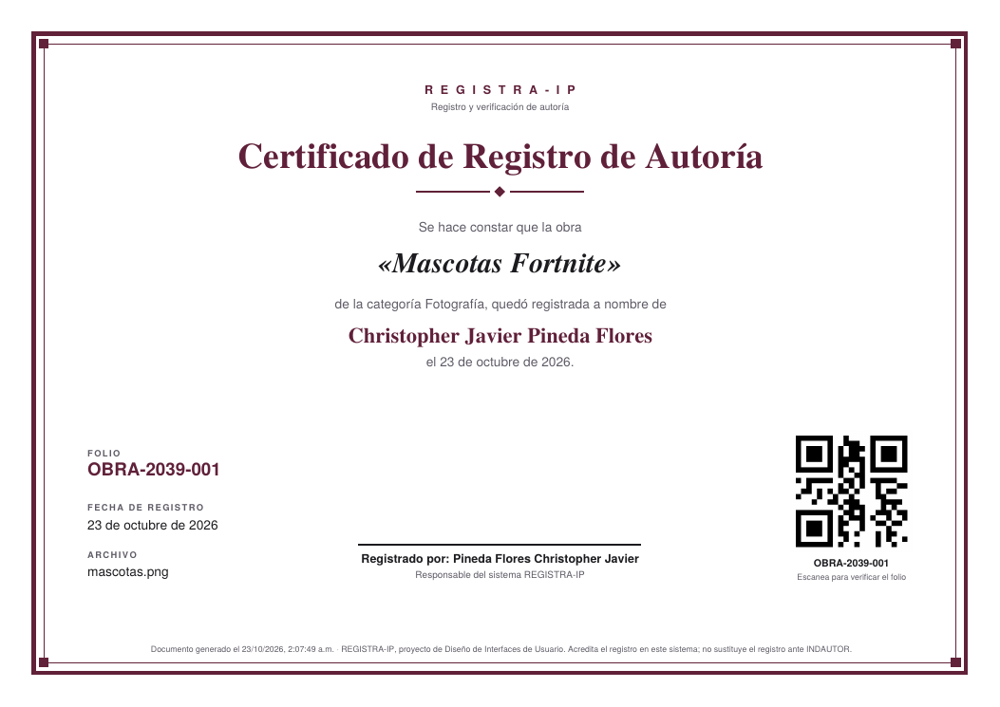
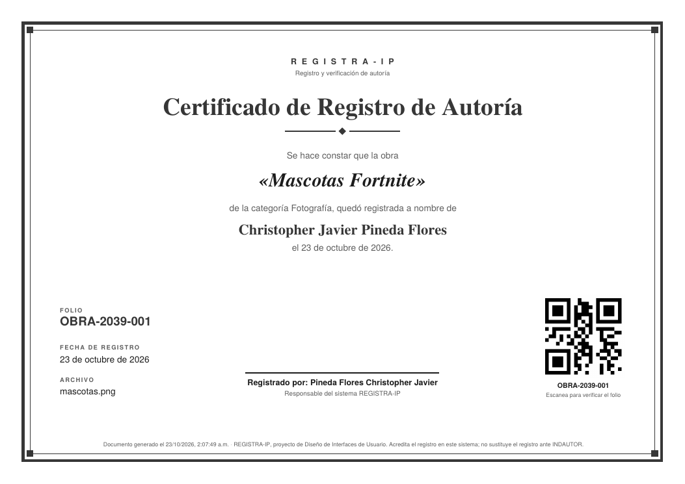

# Práctica 04 — Certificado PDF con folio y código QR

**Alumno:** Pineda Flores Christopher Javier · **Boleta:** 2024602039

## Personalización

- Leyenda: **"Registrado por: Pineda Flores Christopher Javier"**. Está en la constante `REGISTRADO_POR` de `src/config.js` y aparece sobre la línea de firma.
- Folio **`OBRA-2039-###`**: va en los datos de control, debajo del QR, y es el contenido del propio QR.

## Boceto

Antes de programar se definió la retícula: hoja A4 horizontal (297 × 210 mm), un marco a 10 mm del borde, el contenido a 26 mm y un eje central. Los números marcan el orden en que se quiere que el ojo lea.

## Resultado

| Color | Blanco y negro |
|-------|----------------|
|  |  |

## Cómo funciona

| Archivo | Qué hace |
|---------|----------|
| `src/utils/generarCertificado.js` | `generarCertificado(obra)` construye el PDF con jsPDF. `descargarCertificado(obra)` lo guarda con `doc.save("certificado-<folio>.pdf")`. |
| `src/pages/ObraDetalle.jsx` | Vista `/obras/:folio` con los metadatos de una obra y el botón **Descargar certificado**. |
| `src/utils/api.js` | `obtenerObra(folio)` busca la obra en `GET /obras`. |

El QR se crea con `QRCode.toDataURL(folio)`, que da una imagen PNG en base64, y se inserta con `doc.addImage(...)`. Contiene solo el texto del folio (`OBRA-2039-001`), así que cualquier cámara de celular lo muestra tal cual.

## Decisiones de jerarquía visual (defensa oral)

**1. Un solo elemento dominante.** El título *"Certificado de Registro de Autoría"* es lo más grande (Times Bold **30 pt**) y está en el color de marca. Lo primero que se responde es "¿qué documento es este?".

**2. Escala tipográfica con saltos claros.** Hay 5 niveles: 30 → 24 → 18 → 11 → 7.5 pt. Cada nivel es notablemente distinto del anterior, para que no haya dos elementos que "compitan".

| Nivel | Elemento | Fuente |
|-------|----------|--------|
| 1 | Título | Times Bold 30 pt, color marca |
| 2 | Nombre de la obra | Times Bold Itálica 24 pt, casi negro |
| 3 | Autor | Times Bold 18 pt, color marca |
| 4 | Cuerpo ("Se hace constar…", fecha) | Helvetica 11 pt, gris |
| 5 | Etiquetas (FOLIO, FECHA…) y pie | Helvetica 7–7.5 pt, mayúsculas espaciadas |

**3. Dos familias con roles distintos.** La **serif (Times)** se usa en lo ceremonial: título, obra y autor. Da el tono formal de diploma. La **sans (Helvetica)** se usa en lo funcional: datos, etiquetas, leyenda y pie, porque se lee mejor en tamaños chicos.

**4. El texto de unión es secundario.** Las frases "Se hace constar que la obra…" y "…quedó registrada a nombre de" van en 11 pt gris. Conectan la oración sin robar atención a los datos importantes (obra y autor), que van grandes y oscuros.

**5. Alineación consistente.** El bloque principal (título, obra, autor, firma) está **centrado** sobre un eje, como un diploma clásico, porque se lee como una sola frase. Los datos de control (folio, fecha, archivo) van **alineados a la izquierda**, porque son una lista que se escanea. Mezclar centrado y bandera izquierda dentro del mismo bloque se vería desordenado; por eso cada bloque usa una sola alineación.

**6. Tres zonas abajo: datos | firma | QR.** Equilibran la composición. Lo que se *verifica* (folio y QR) queda en los extremos y la firma en el centro, sobre el eje.

**7. Etiqueta + valor.** Cada dato tiene una etiqueta pequeña en mayúsculas espaciadas encima de un valor más grande. El ojo encuentra el valor rápido, y la etiqueta explica qué es sin repetir palabras.

**8. Espacio en blanco y márgenes generosos.** Hay 26 mm de margen interior y aire alrededor del título y del separador con rombo. El espacio en blanco agrupa por **proximidad** (Gestalt): lo que está junto se lee como una unidad, y así no hacen falta cajas.

**9. Marco doble.** Un filete grueso exterior y uno fino interior, con pequeños cuadros en las esquinas, dan el carácter de "documento oficial" sin adornos que distraigan.

**10. Legible en blanco y negro.** Ninguna información depende solo del color. La jerarquía la dan el **tamaño**, el **peso** (bold/regular) y la **familia** (serif/sans). El color #602039 es muy oscuro (contraste 11.91:1), así que al imprimir en gris se ve casi negro. El QR es negro puro sobre blanco para máximo contraste. (Ver la imagen en B/N arriba.)

## Verificación

| Prueba | Resultado |
|--------|-----------|
| Botón **Descargar certificado** en `/obras/OBRA-2039-001` | Descarga `certificado-OBRA-2039-001.pdf` (≈ 7 KB) |
| Escaneo del QR con la cámara del celular | Muestra `OBRA-2039-001` |
| Escaneo del QR del PDF impreso en escala de grises | Muestra el folio correctamente |
| Título de obra muy largo | Se divide en 2 líneas centradas y el resto del diseño se recorre |
| Folio inexistente (`/obras/OBRA-2039-999`) | "Obra no encontrada" con botón para volver |
